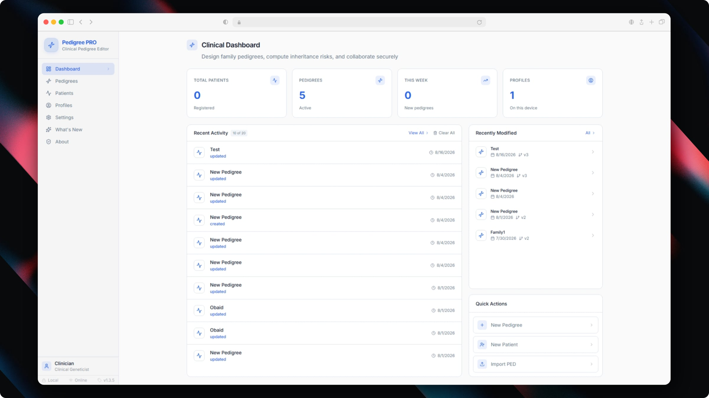
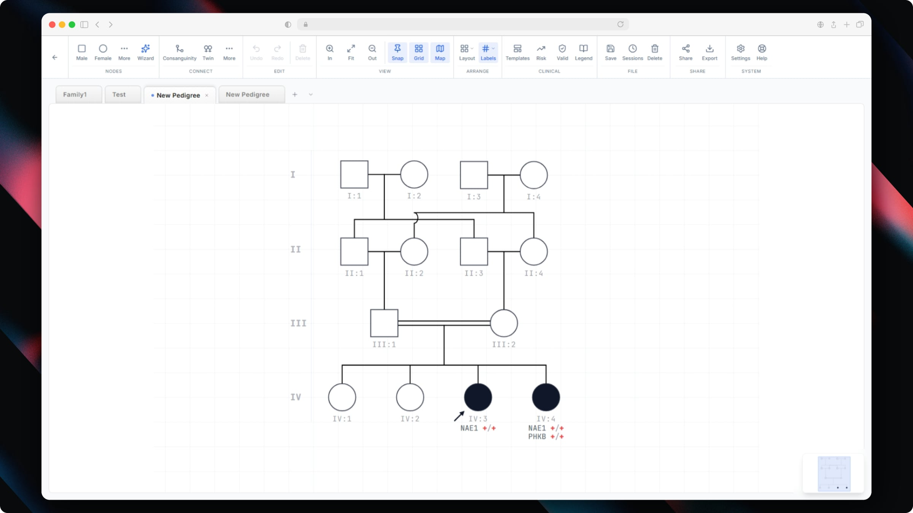

<div align="center">

# Pedigree PRO

**Local-first clinical pedigree editor**

[](https://github.com/Huthaifa-HajAhmad/Pedigree-PRO/releases)
[](LICENSE)
[](docs/COMPLIANCE-HIPAA.md)

A privacy-first pedigree drawing tool for clinical geneticists and researchers. No cloud. No accounts. No data leaves your device.

[Download](#installation) · [Features](#features) · [Architecture](#architecture) · [Contributing](CONTRIBUTING.md) · [Security](SECURITY.md) · [Roadmap](ROADMAP.md)

<br />

<p align="center">
  
</p>

</div>

> **Statutory Notice & Clinical Disclaimer:** Pedigree PRO is an open-source software suite designed for academic research, genetic data visualization, and pedigree drawing. It is **not** an FDA-cleared, CE-marked, or certified medical device and is not intended for direct clinical diagnostic or therapeutic decision-making without independent professional verification.

---

## Features

### Pedigree Canvas
- Interactive pedigree editor with drag-and-drop, auto-layout, and snap guides
- Standard genetic nomenclature: male/female/unknown symbols, twins, consanguinity, adoption
- Sibship groups, relationship lines, and annotation overlays
- Context menu with keyboard navigation for quick node operations
- Minimap, find bar, and zoom controls for large pedigrees
- Version history with virtualized thumbnail previews for 50+ versions
- **Interactive onboarding tour** — guided walkthrough modal for first-time users
- **Smart genotype rendering** — dynamic rendering of genotype strings beneath pedigree nodes with custom colors, font sizes, and offsets

### Clinical Annotations & Risk
- HPO terms, OMIM IDs, variant HGVS notation per node
- Phenotype tracking with inheritance mode
- Affected/carrier/unaffected status indicators via segmented panel controls
- Genotype input fields with quick selector presets (`+/-`, `+/+`, `-/-`, `+/Y`, `-/Y`)
- Risk calculator panel with evidence details

### Clinical Dashboard & Records
- Local-first patient records and pedigree version timeline
- Multi-profile clinician management with cryptographic key isolation
- Comprehensive mutation audit trail for clinical governance

<p align="center">
  
</p>

### Privacy & Compliance
- **Zero-server architecture** — no cloud, no accounts, no telemetry
- **Encrypted at rest** — AES-256-GCM (browser) or SQLCipher (desktop)
- **HIPAA-aligned** — no third-party services, keys stored in IndexedDB (never localStorage)
- Self-hosted fonts — no Google Fonts CDN calls (IP leak prevention)

### Sharing & Collaboration
- **Zero-knowledge relay** — encrypted blob relay for secure asynchronous sharing (tokens auto-expire)
- **Self-contained encrypted links** — compressed base64url share URLs requiring zero server infrastructure
- **Hybrid encryption** — Ed25519 keypairs + AES-256-GCM envelopes per recipient
- Share log for HIPAA audit trail

### Export
- PDF, PNG, PowerPoint (PPTX), and native `.ppro` format
- Professional export themes (clinical, dark, high-contrast)
- Clipboard copy for paste-into-EMR workflows

### Multi-Profile
- Multiple clinician profiles on one device
- Ed25519 keypair per profile for signing and encryption
- Profile selection on startup

---

## Architecture

```
┌─────────────────────────────────────────────────────────┐
│                    React + Vite Frontend                │
│            (artifacts/ppro — unified codebase)          │
├──────────────────────┬──────────────────────────────────┤
│   Tauri Desktop      │       Browser Standalone          │
│   ┌──────────────┐   │   ┌───────────────────────────┐  │
│   │  Rust IPC    │   │   │  sql.js WASM (IndexedDB)  │  │
│   │  SQLCipher   │   │   │  Web Crypto API           │  │
│   │  (filesystem)│   │   │  (browser storage)        │  │
│   └──────────────┘   │   └───────────────────────────┘  │
└──────────────────────┴──────────────────────────────────┘
```

The frontend uses a **unified adapter** (`lib/api-client-react/src/adapter.ts`) that detects the runtime at launch:
- `window.__TAURI__` present → Tauri IPC (`invoke`) → Rust backend → SQLCipher on disk
- Otherwise → lazy-loads `@workspace/browser-backend` → sql.js WASM → IndexedDB + Web Crypto

**No REST API. No Postgres. No internet required.**

### Key Packages

| Package | Role |
|---|---|
| `artifacts/ppro` | React + Vite frontend (canvas, dashboard, patients, profiles) |
| `lib/api-client-react` | Unified adapter + React Query hooks + direct API functions |
| `lib/browser-backend` | sql.js WASM SQLite, IndexedDB persistence, Web Crypto, TypeScript command port |
| `lib/crypto` | Shared Ed25519, SHA-256, AES-GCM, libsodium sealed-box primitives |
| `lib/db` | Drizzle schemas + SQLite migrations |

---

## Installation

Latest release binaries are built automatically in CI for Windows, macOS, and Linux:

| Platform | Format | Download |
|---|---|---|
| **Windows** | MSI (enterprise) | [`Pedigree.PRO_1.2.5_x64_en-US.msi`](https://github.com/Huthaifa-HajAhmad/Pedigree-PRO/releases/download/v1.2.5/Pedigree.PRO_1.2.5_x64_en-US.msi) |
| | NSIS (standard) | [`Pedigree.PRO_1.2.5_x64-setup.exe`](https://github.com/Huthaifa-HajAhmad/Pedigree-PRO/releases/download/v1.2.5/Pedigree.PRO_1.2.5_x64-setup.exe) |
| **macOS** | DMG (universal) | [`Pedigree.PRO_1.2.5_universal.dmg`](https://github.com/Huthaifa-HajAhmad/Pedigree-PRO/releases/download/v1.2.5/Pedigree.PRO_1.2.5_universal.dmg) |
| **Linux** | AppImage | [`Pedigree.PRO_1.2.5_amd64.AppImage`](https://github.com/Huthaifa-HajAhmad/Pedigree-PRO/releases/download/v1.2.5/Pedigree.PRO_1.2.5_amd64.AppImage) |
| | Debian | [`pedigree-pro_1.2.5_amd64.deb`](https://github.com/Huthaifa-HajAhmad/Pedigree-PRO/releases/download/v1.2.5/pedigree-pro_1.2.5_amd64.deb) |
| | RPM | [`pedigree-pro-1.2.5.x86_64.rpm`](https://github.com/Huthaifa-HajAhmad/Pedigree-PRO/releases/download/v1.2.5/pedigree-pro-1.2.5.x86_64.rpm) |


### Browser Mode

Open `index.html` from the built `dist/public/` directory, or serve it locally:

```bash
pnpm --filter @workspace/ppro run dev
# → http://localhost:4173
```

---

## Development

### Prerequisites

- **Node.js** 22+ (LTS) and **pnpm**
- **Rust toolchain** (Tauri desktop builds only)
- **VS Build Tools 2022** + **OpenSSL** (Windows, Tauri builds only)

### Setup

```bash
# Install dependencies (bypasses preinstall guard)
pnpm install --ignore-scripts

# Build workspace libraries
pnpm -r --if-present run build

# Start frontend dev server (browser mode)
pnpm --filter @workspace/ppro run dev
```

### Typecheck & Test

```bash
pnpm run typecheck
pnpm --filter @workspace/ppro run test
```

### Build Tauri Desktop

Building locally on Windows requires **Strawberry Perl** to compile the vendored OpenSSL library from source:

```powershell
# Install Perl (Windows)
choco install strawberryperl -y

# Build desktop binaries (MSI + NSIS)
cd artifacts/ppro
pnpm tauri build
```

### Frontend-Only Build

```bash
npx vite build --config artifacts/ppro/vite.config.ts
```

---

## Tech Stack

| Layer | Technology |
|---|---|
| Frontend | React 19, Vite 7, Tailwind CSS 4, Radix UI |
| State | React Query, React Hook Form, Zod |
| Canvas | Custom SVG pedigree engine, html2canvas |
| Desktop | Tauri 2, Rust, SQLCipher |
| Browser | sql.js (WASM SQLite), IndexedDB, Web Crypto API |
| Crypto | Ed25519 (@noble/ed25519), AES-256-GCM, PBKDF2 |
| Export | jsPDF, pptxgenjs, DOMPurify |

---

## Security Model

### Encryption at Rest
- **Browser**: Database blob encrypted with AES-256-GCM before writing to IndexedDB. Key wrapped with a second AES key. Optional passphrase via PBKDF2-HMAC-SHA512 (256k iterations).
- **Desktop**: SQLCipher database file on disk.

### Profile Keys
- Ed25519 keypairs generated in-browser via `@noble/ed25519`
- Private keys stored exclusively in IndexedDB via `idb-keyval`
- **Never stored in localStorage** (XSS-vulnerable)

### Data Privacy
- No server. No cloud sync. All data stays on the local device.
- Relay sharing uses zero-knowledge hybrid encryption; the relay operator never accesses plaintext data.

---

## AI-Assisted Development

This project was developed with the assistance of agentic AI coding models (specifically Google DeepMind's Antigravity) to enable rapid auditing, automated testing, and secure cross-platform execution.

---

## License

Pedigree PRO is licensed under the [Apache License, Version 2.0](LICENSE).  
Copyright © 2026 Huthaifa HajAhmad.


